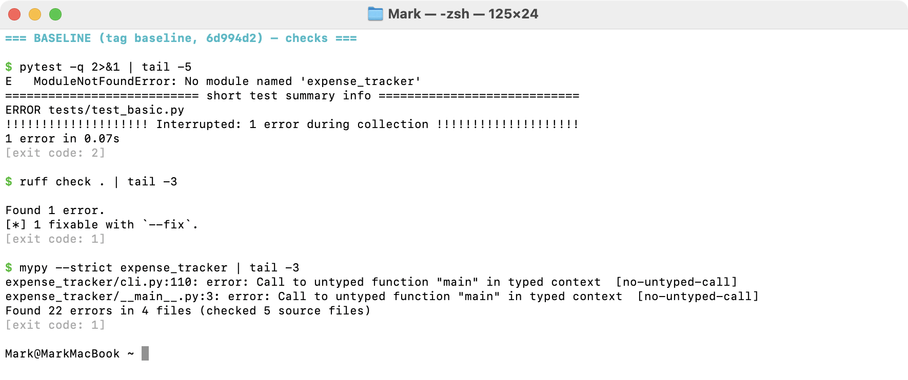
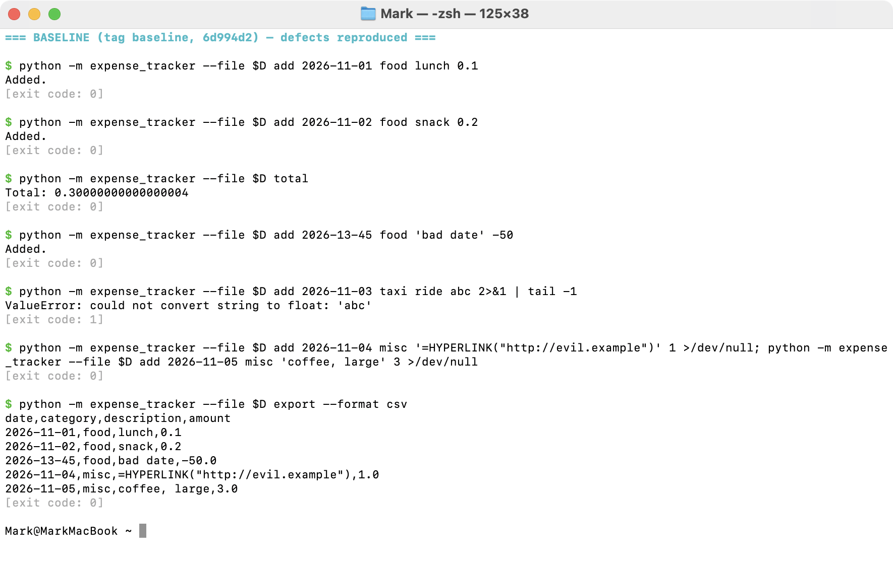
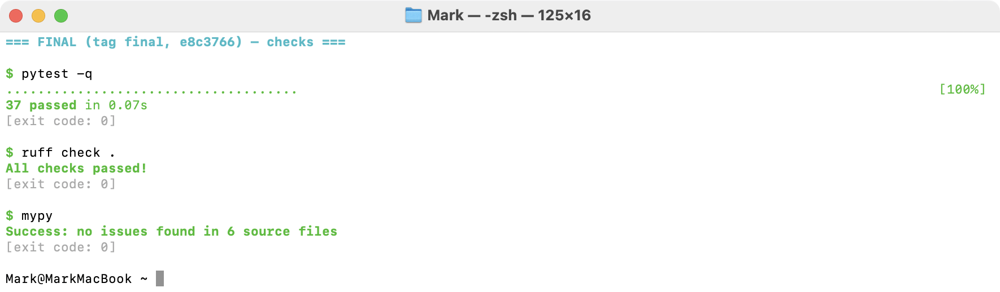
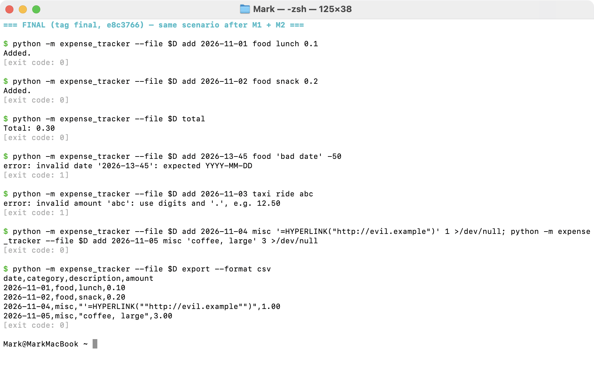

# Assignment #05 — AI-assisted repository customization, agent readiness and risk governance

**Repository:** `expense-tracker`, a small Python command-line expense tracker (no external runtime dependencies)
**Baseline:** tag `baseline`, commit `6d994d2` · **Final:** tag `final`, commit `e8c3766` (later commits only add documentation and screenshots)
**Date:** 2026-11-22 · **Work mode:** individual

Every command result quoted here was copied from a real run. The raw outputs are in [`docs/evidence/`](evidence/), listed in Appendix B. Nothing was estimated or made up. Any check that was not executed is stated as such (see §7.4).

> The baseline project was created specifically for this assignment, because no suitable small repository of my own was available. Appendix A says how it was produced.

---

## 1. Task 1 — Baseline and context

### 1.1 Repository map (at `baseline`)

| Kind | Item |
|---|---|
| Entry points | `python -m expense_tracker` (`expense_tracker/__main__.py`), console script `expense-tracker` → `expense_tracker.cli:main` (in `pyproject.toml`) |
| Modules | `cli.py`: argparse, sub-commands `add/list/total/export/summary`, and all output formatting · `models.py`: `Expense` dataclass · `storage.py`: JSON load/save, path taken from `--file` or `$EXPENSES_FILE`, default `./expenses.json` |
| Dependencies | Runtime: standard library only. Dev: `requirements-dev.txt` = `pytest`, `ruff`, `mypy` (**unpinned**). Build: `setuptools>=61` |
| Tests | `tests/test_basic.py`: 2 happy-path tests (save/load round-trip, total by category) |
| Build | `pyproject.toml` (setuptools); `python -m build` |
| Docs | `README.md` (install and usage); no agent instructions, no CI |

Structure after the work (differences in **bold**): `expense_tracker/{__init__,__main__,cli,models,storage,`**`exporters`**`}.py`, `tests/{test_basic,`**`test_cli_output,test_validation,test_exporters`**`}.py`, **`AGENTS.md`, `CLAUDE.md`, `docs/`**.

### 1.2 Baseline commands and actual results

Tools: Python 3.13.7, pytest 9.2.0, ruff 0.17.6, mypy 2.4.1, pip-audit 2.10.1, build 1.6.1. Sources: [`baseline_checks.txt`](evidence/baseline_checks.txt), [`baseline_smoke.txt`](evidence/baseline_smoke.txt).

| Command | Result at baseline |
|---|---|
| `.venv/bin/pytest -q` | **ERROR, exit 2.** `ModuleNotFoundError: No module named 'expense_tracker'`: the test command in the README doesn't work |
| `.venv/bin/python -m pytest -q` | 2 passed, exit 0 (works only because `python -m` puts the current directory on `sys.path`) |
| `.venv/bin/ruff check .` | 1 error (I001, unsorted imports in `models.py`), exit 1 |
| `.venv/bin/mypy --strict expense_tracker` | **22 errors in 4 files**, exit 1 (no type annotations) |
| `python -m build` | sdist and wheel built, exit 0 |
| `pip-audit -r requirements-dev.txt` | No known vulnerabilities, exit 0 |
| `python -m expense_tracker report` (from the README) | `invalid choice: 'report'`, exit 2: **the README documents a command that doesn't exist** |

### 1.3 Acceptance criteria

| ID | Criterion | Automated check | Baseline | Final |
|---|---|---|---|---|
| AC1 | An expense added with `add` appears unchanged in `list` and survives save/load | `test_add_and_load`, `test_amount_round_trips_exactly` | ✅ | ✅ |
| AC2 | `total` / `summary` are exact to the cent (0.10 + 0.20 = 0.30) | `test_total_is_exact_to_the_cent`, `test_total_by_category` | ❌ `0.30000000000000004` | ✅ `0.30` |
| AC3 | `export` produces well-formed CSV / JSON / Markdown with one row per expense | `test_cli_output.py`, `test_exporters.py` | ⚠️ ordinary data ok, but a comma in a description breaks the CSV | ✅ |
| AC4 | Invalid input or a corrupt data file → `error: …` on stderr, exit 1, no traceback, nothing saved | `test_validation.py` | ❌ tracebacks; bad data saved | ✅ |
| AC5 | `pytest`, `ruff check`, `mypy` (strict) and `build` all succeed | [`final_checks.txt`](evidence/final_checks.txt) | ❌ | ✅ |

AC1 and AC3 (ordinary data) already held at baseline and had to stay true. AC2, AC4 and AC5 are the target state the changes had to reach.

### 1.4 Weaknesses identified at baseline (with evidence)

| # | Weakness | Evidence |
|---|---|---|
| W1 | Money is stored as `float`, so totals are wrong | `models.py:9 amount: float`; smoke run `total` → `Total: 0.30000000000000004` |
| W2 | No input validation: impossible dates and negative amounts are saved; bad numbers crash | `add 2026-13-45 food 'bad date' -50` → `Added.`; `add … abc` → `ValueError` traceback |
| W3 | A corrupt data file crashes every command | `echo '{not json' > $D; … list` → `JSONDecodeError` traceback |
| W4 | CSV export doesn't quote fields or neutralise formulas | `coffee, large` exported as 5 columns; `=HYPERLINK(...)` exported raw |
| W5 | Reproducibility: `pytest` fails without an editable install, the README is wrong, dev deps are unpinned | See §1.2; `requirements-dev.txt` has no versions |
| W6 | No agent instructions, no CI, no enforced quality gates | No `AGENTS.md`, `.github/` or pre-commit config in the baseline tree |

### 1.5 Facts, assumptions and unverified suggestions

- **Observed facts** (reproduced by a command, see logs): W1–W6. The second baseline ruff run also flagged I001 and UP007 even though the repo had no ruff configuration, while `ruff check --isolated` passed. So lint results depended on configuration **outside the repository**. I couldn't find where that configuration lives; the fact itself was reproduced.
- **Assumptions** (not tested): users open CSV exports in a spreadsheet program, which is what makes formula injection matter. A crash during `save()` would truncate the file (true from reading the code, never reproduced).
- **Unverified AI suggestions** are kept apart in §4 and only enter the register once a command has confirmed them.

---

## 2. Task 2 — Agent instructions

[`AGENTS.md`](../AGENTS.md) at the repository root covers:

- §1 purpose
- §2 architecture table and data flow
- §3 setup
- §4 **safe commands** that may run without asking (pytest, ruff, mypy, CLI runs **only against a scratch `--file`**, read-only git)
- §5 coding conventions (Decimal for money, no printing in business logic, errors without tracebacks)
- §6 test expectations (every fix ships with a test that fails without it; tests use `tmp_path` only)
- §7 **forbidden actions**: secrets or real personal data, deploying/publishing/pushing, destructive commands (`rm -rf`, `git reset --hard`, `push --force`, rewriting history, deleting tags or evidence), dependency changes without human review, network access, skipping tests, editing outside the repository
- §8 **review gates**: real check output → diff with summary and risk notes → human approval before commit → explicit approval for dependency or data-format changes

**Disclosure on how the file is loaded:** the coding agent I used reads `CLAUDE.md`, not `AGENTS.md`, automatically. So `CLAUDE.md` contains just one import line, `@AGENTS.md`, which keeps a single source of truth. Once the file existed, the instructions were loaded into the agent's context automatically and the agent obeyed them. Under §8.3/§8.4 it stopped and asked me to approve the M1/M2 diff, which changes the data format, and the dependency pinning, before committing either. No instructions had to be pasted in by hand.

---

## 3. Task 3 — Focused pattern decision

**Problem (concrete, measured):** at baseline, `cli.py` repeated the same `if args.format == "csv" / "json" / "md" / else` chain twice, in `cmd_export` and `cmd_summary`: **6 `args.format ==` comparisons**. Formatting was also mixed into the command handlers. Adding a format meant editing two branches and two error paths.

**Options considered:**
- *No pattern, use a dict of functions.* Possible, but each format has two related operations (expenses and summary), and keeping them in one object keeps them together.
- *Strategy* (chosen). One small class per format implementing an `Exporter` protocol (`expenses()`, `summary()`), plus a registry `EXPORTERS: dict[str, Exporter]`.
- *Adapter.* Rejected: there is no external interface to adapt.

**Why the pattern is justified, and is the only one used:** it removes real duplication. Valid formats now come from one place (`argparse choices=sorted(EXPORTERS)`). A new format is one class and one registry entry. It also became the single place where M2 (safe CSV) had to be fixed. Nothing else was abstracted.

| | Before (`baseline`) | After (`465ed5e`) |
|---|---|---|
| Format branching in `cli.py` | 6 `args.format ==` comparisons in 2 functions | 0. `EXPORTERS[args.format]` |
| `cli.py` size | 110 lines | 84 lines (+55 in `exporters.py`) |
| Unknown format | prints `unknown format`, exit 1 | argparse error listing valid choices, exit 2 |

**Proof that behaviour was preserved:** 8 characterisation tests (`tests/test_cli_output.py`, commit `b31fc42`) were written **before** the refactor against the old code. All 10 tests passed unchanged after it ([`task3_refactor_tests.txt`](evidence/task3_refactor_tests.txt)). The one intentional difference is the exit code for an unknown format, which goes from 1 to 2 (still non-zero, which is all the test requires).

---

## 4. Task 4 — Read-only AI risk review

A separate read-only AI sub-agent with no edit or write tools was asked to propose risks without modifying anything. The prompt is in [`task4_ai_risk_review_prompt.txt`](evidence/task4_ai_risk_review_prompt.txt) and the verbatim answer in [`task4_ai_risk_review_output.md`](evidence/task4_ai_risk_review_output.md). `git status` afterwards showed no changes to tracked files. I checked each candidate claim with commands on a scratch data file ([`task4_verification.txt`](evidence/task4_verification.txt)).

| AI # | Claim | Category | Verdict | Evidence |
|---|---|---|---|---|
| 1 | Money is `float`, so totals are wrong | correctness | **Confirmed** | `total` → `0.30000000000000004` |
| 1b | Switching to Decimal will break the locked characterisation tests | maintainability | **Confirmed** | 5 tests in `test_cli_output.py` failed after M1 until expectations were updated |
| 2 | No validation: `abc` → traceback, `nan` → `Total: nan`, negatives accepted, missing field → `KeyError` | correctness | **Confirmed** | All four reproduced (exit codes 1 / 0 / 0 / 1) |
| 3 | `save()` isn't atomic, so a crash truncates the file | correctness | **Plausible / unverified** | `storage.py:18 open(path, "w")` confirms the cause; a crash was **not** reproduced |
| 4 | CSV/MD not escaped: broken columns and formula injection | security | **Confirmed** | CSV row lengths `[4, 5, 4, 4]`; `=1+1` and `a\|b` exported raw |
| 5 | `export --output` can overwrite the data file | correctness / security | **Confirmed** | `--output $D` then `list` → `JSONDecodeError`, exit 1 |
| 6 | Dev/build dependencies unpinned | dependency | **Confirmed** | `requirements-dev.txt` had no versions; `setuptools>=61` |
| 7 | Plain `mypy` passes and gives false confidence | maintainability | **Confirmed** | `mypy` → "Success"; `--disallow-untyped-defs` → 12 errors |
| 7b | Stale `egg-info/SOURCES.txt` | maintainability | **Confirmed but rejected as a risk** | It is git-ignored build output, regenerated on install |
| 7c | `__main__.py` has no `if __name__` guard | maintainability | **Unsupported as a risk** | The module exists only to be run with `python -m`; nothing imports it |
| 8a | Running without `--file` writes `./expenses.json` (real data) | agent operations | **Confirmed** | Running in an empty directory created `expenses.json` there |
| 8b | `EXPENSES_FILE` is read at import time | agent operations | **Plausible, low** | True in the code; irrelevant for separate CLI processes (`EXPENSES_FILE=… add` worked) |
| 8d-1 | Gates aren't enforced (no CI, hooks or permission config) | agent operations | **Confirmed** | `ls .claude .github .pre-commit-config.yaml` → none exist |
| 8d-2 | "The folder is not a git repository", so the tags may not work | agent operations | **Unsupported** | `git rev-parse --is-inside-work-tree` → `true`; `git tag` → `baseline`. The claim came from stale environment metadata, not from the repository |

The review produced 14 claims across 4 categories: 10 confirmed (one of them confirmed but rejected as a risk), 2 plausible and 2 unsupported.

---

## 5. Task 5 — Risk register

Likelihood (L) and impact (I) are scored 1–3. Score = L × I. "Before" means the state at commit `465ed5e`, the state that was reviewed.

| ID | Category | Cause → event → consequence | Component | Evidence | L | I | Score | Mitigation | Owner | Verification | Residual |
|---|---|---|---|---|---|---|---|---|---|---|---|
| **R2** | correctness | No validation or error handling → user mistypes an amount or date, or the file is corrupt → traceback, or invalid data (`nan`, negative, `2026-13-45`) is saved and poisons every total | `models.py`, `cli.py`, `storage.py` | task4 §F2, baseline smoke | 3 | 3 | **9** | **M1** | Maintainer | `test_validation.py` (16 cases) | Low (L1·I2=2) |
| R1 | correctness | Binary float for money → decimal amounts are summed → totals off by rounding error | `models.py`, `cli.total` | `0.30000000000000004` | 3 | 2 | 6 | **M1** (same code path) | Maintainer | `test_total_is_exact_to_the_cent` | Very low (1·1=1) |
| **R3** | security | CSV fields not quoted or neutralised → a description starts with `=`/`+`/`-`/`@` or contains `,` → spreadsheet runs a formula (e.g. a `HYPERLINK` to an attacker's URL) or columns shift | `exporters.py` CSV/MD | Row lengths `[4,5,4,4]`, raw `=HYPERLINK` | 2 | 3 | 6 | **M2** | Maintainer | `test_exporters.py` (11 cases) | Low (1·2=2) |
| R4 | correctness / security | `--output` accepts any path → user or agent passes the data file path → JSON store overwritten with CSV, history unreadable | `cli.cmd_export` | task4 §F5 | 2 | 3 | 6 | Planned: refuse `--output` equal to `--file`; don't overwrite without `--force` | Maintainer | New test, to be added | **Open** (2·3=6) |
| R8 | agent operations | Default data path is `./expenses.json`; gates exist only as text → an agent runs the CLI without `--file`, or commits without review → real data touched or unreviewed change merged | `storage.DEFAULT_PATH`, repo process | task4 §F8a, §F8d-1 | 2 | 2 | 4 | AGENTS.md §4/§7/§8 (done); planned: CI + agent permission settings | Maintainer | CI run, settings file | Open (2·2=4) |
| R6 | dependency | Unpinned dev tools and lint rules from outside the repo → a fresh install brings new versions or rules → gates fail or pass for reasons unrelated to the code | `requirements-dev.txt`, `pyproject.toml` | §1.5, task4 §F6 | 2 | 2 | 4 | Pinned versions, explicit `[tool.ruff]`/`[tool.mypy]` (commit `7e5b203`) | Maintainer | `pip install -r …` + checks in `final_checks.txt` | Low (1·2=2); build backend `setuptools>=61` still a range, no hashes |
| R5 | correctness | Non-atomic `save()` → crash, Ctrl-C or two concurrent runs → truncated file or lost update | `storage.save` | Code only (plausible) | 1 | 3 | 3 | Planned: write to a temp file + `os.replace`, keep a `.bak` | Maintainer | Fault-injection test, to be added | Open (1·3=3) |
| R7 | maintainability | Untyped code + default mypy → type errors pass the gate | all modules | task4 §F7 | 3 | 1 | 3 | Full annotations + `mypy --strict` in config (M1 / `7e5b203`) | Maintainer | `mypy` → Success (strict) | Very low (1·1=1) |

**Top two confirmed risks chosen for corrective action:** **R2 (score 9)** and **R3 (score 6)**. Three risks are tied at 6 (R1, R3, R4). I chose R3 because it is the only **security** risk with harm beyond the user (an exported file is often shared), and because R1 is fixed anyway in the same code path as R2. R4 stays open with an owner and is a condition of the release decision (§9).

---

## 6. Task 6 — Agent-readiness audit (final state)

| Area | Status | Evidence |
|---|---|---|
| Readable structure | ✅ 4 small modules with one responsibility each; Strategy for formats | §1.1, §3 |
| README accuracy | ✅ Fixed. The nonexistent `report` command and missing `requirements.txt` replaced by working commands | commit `dadd7d7`; `final_smoke.txt` |
| Reproducible setup | ✅ venv + pinned `requirements-dev.txt` + `pip install -e .`; `pytest` works without `python -m` (`pythonpath` in pyproject) | `final_checks.txt` |
| Pinned dependencies | ⚠️ Dev tools pinned exactly; build backend still `setuptools>=61`; no hash lock | `requirements-dev.txt`, `pyproject.toml` |
| Tests | ✅ 37 tests: happy path, characterisation, validation, export security | `final_tests_verbose.txt` |
| Lint / types | ✅ ruff (E, F, I, UP) clean; `mypy --strict` clean; rules declared in the repository | `final_checks.txt` |
| Build | ✅ sdist + wheel | `final_checks.txt` |
| Logging | ⚠️ None. Errors go to stderr with clear messages, but there is no logging (acceptable for a CLI this size) | `cli.main` |
| Security safeguards | ✅ input validation, CSV injection defence, `pip-audit` clean · ⚠️ R4 open | §5 |
| AGENTS.md: permissions, safe commands, forbidden actions, review gates | ✅ all present; showed working in this session (the agent paused for approval) | §2 |
| Enforcement of gates | ❌ No CI, no pre-commit hook, no agent permission config file | `ls .github .pre-commit-config.yaml .claude` |

**Readiness level: 2 — Documented.** Documentation, setup, safe and forbidden commands and checks are complete, and every check passes in the final version. Level 3 (Agent-ready) is **not** claimed because these items are still missing:
1. No CI pipeline that runs pytest, ruff, mypy and build on every change. The gates are only text.
2. No technical enforcement of the forbidden actions (agent permission settings, pre-commit hook).
3. Open data-safety risks that an autonomous agent could trigger: R4 (overwrite through `--output`) and R8 (default data path in the working directory).
4. No hash-locked dependencies (`pip-compile --generate-hashes` or similar).

---

## 7. Task 7 — Mitigation and verification

### 7.1 Mitigation record M1: R2 + R1 (commit `a213efd`)

- **Change:**
  - `models.py`: `parse_amount()` gives a positive `Decimal` with exactly 2 decimals and rejects `nan`, `inf`, `0`, negatives, more than 2 decimals and `12,50`.
  - `parse_date()` accepts ISO `YYYY-MM-DD` only.
  - Validation runs in `Expense.__post_init__`, and `from_dict` turns a missing field into `ValidationError`.
  - `storage.load()` turns invalid JSON or a non-list into `StorageError`.
  - `cli.main()` catches both errors and prints `error: …` with exit 1.
  - `cmd_add` validates **before** loading or saving.
  - Totals use `Decimal`.
- **Data-format change (approved by a human, AGENTS.md §8.4):** `amount` is now stored as a JSON string (`"12.50"`). Old files with numeric amounts still load (`test_legacy_float_amounts_still_load`). Output always shows 2 decimals (`5.0` → `5.00`), so the characterisation expectations were updated on purpose in the same commit.
- **Review of the proposed diff:** I read the diff ([`mitigations_M1_M2.diff`](evidence/mitigations_M1_M2.diff)) before approving. I checked that `nothing is saved` on invalid input (`assert not f.exists()`), that the legacy format still loads, and that the only changes to existing tests were to formatting.
- **Tests (TDD):** 16 new test cases written first. All but one failed against the old code ([`mitigation_tests_before.txt`](evidence/mitigation_tests_before.txt)); `test_legacy_float_amounts_still_load` passes on both versions because it guards backward compatibility. All pass after the change.

### 7.2 Mitigation record M2: R3 (commit `f24d7e2`)

- **Change:** CSV is written with `csv.writer`, which quotes `,`, `"` and newlines. Text cells that start with `= + - @ \t \r` get a `'` prefix (the OWASP CSV-injection guidance). Markdown cells escape `|` and replace newlines with spaces. Amounts and dates aren't prefixed (they are validated, and amounts are always positive).
- **Review of the proposed diff:** confirmed that the sanitising applies to category as well as description, and that the summary export is covered too. Confirmed that ordinary text exports byte-for-byte the same as before (`test_csv_plain_text_unchanged`, characterisation tests).
- **Tests:** 11 new cases, 10 failing before and all passing after. The exception is `test_csv_plain_text_unchanged`, which also passed before, as intended.

### 7.3 Extra fix (not counted as a mitigation): R6 + R7 (commit `7e5b203`, approved under AGENTS.md §7)

Pinned `pytest==9.2.0 ruff==0.17.6 mypy==2.4.1 pip-audit==2.10.1 build==1.6.1`. Declared `[tool.ruff]` (`E, F, I, UP`, line length 110) and `[tool.mypy] strict = true` in `pyproject.toml`. Declaring the ruff rules explicitly turned up 15 E501 lines that the external configuration had hidden; they were fixed by setting the line length and wrapping one line.

### 7.4 Before / after evidence

| Check | Baseline (`6d994d2`) | Final (`7e5b203`) |
|---|---|---|
| `pytest -q` | exit 2, collection error (0 run) | **37 passed, 0 failed**, exit 0 |
| `ruff check .` | 1 error | All checks passed |
| `mypy` strict | 22 errors | Success, 6 files |
| `build` | ok | ok |
| `pip-audit` | no known vulnerabilities | no known vulnerabilities |
| Smoke `0.1 + 0.2` | `0.30000000000000004` | `0.30` |
| Smoke invalid date or amount | saved, or traceback | `error: invalid date …`, exit 1 |
| Smoke CSV row lengths | `[4, 5, 4, 4]` | `[4, 4, 4, 4, 4]` |
| Smoke corrupt file | traceback | `error: data file … is not valid JSON`, exit 1 |

Sources: [`baseline_checks.txt`](evidence/baseline_checks.txt), [`baseline_smoke.txt`](evidence/baseline_smoke.txt), [`final_checks.txt`](evidence/final_checks.txt), [`final_smoke.txt`](evidence/final_smoke.txt), [`final_tests_verbose.txt`](evidence/final_tests_verbose.txt). Screenshots of the same runs follow below.

**Screenshots** (real Terminal windows, macOS, 2026-11-22; files in [`docs/evidence/screenshots/`](evidence/screenshots/)).
The baseline was run from an export of tag `baseline` in a separate clean venv with the same tool versions, so the editable install of the final code couldn't mask the baseline import error. `$D` is a scratch data file in a temp directory. Exit codes are real (`set -o pipefail`).

*Figure 1 — Baseline checks: `pytest` collection error, ruff 1 error, `mypy --strict` 22 errors.*

*Figure 2 — Baseline defects: float total `0.30000000000000004`, invalid date and negative amount accepted, traceback on `abc`, raw `=HYPERLINK(...)` and unquoted comma in CSV.*

*Figure 3 — Final checks: 37 passed, ruff clean, strict mypy clean.*

*Figure 4 — Final, same scenario: `Total: 0.30`, clear `error:` messages with exit 1, formula neutralised with `'`, comma field quoted.*

**Not executed:** no CI run (no pipeline exists); no fault-injection or concurrency test for R5; the CSV defence was checked on the CSV text, not by opening the file in Excel or LibreOffice; tests ran only on macOS with Python 3.13 (3.10–3.12 and Windows untested).

### 7.5 Updated risk scores

| ID | Before | After | Note |
|---|---|---|---|
| R2 | 9 | 2 | Residual: validation covers format and range, not plausibility (e.g. a typo of 1000 instead of 100) |
| R1 | 6 | 1 | |
| R3 | 6 | 2 | Residual: the `'` prefix changes what users see; other tools that read the CSV must strip it |
| R6 | 4 | 2 | Residual: build backend range, no hashes |
| R7 | 3 | 1 | |
| R4 | 6 | 6 | Open, see §9 |
| R8 | 4 | 4 | Open; partly controlled by AGENTS.md |
| R5 | 3 | 3 | Open |

**Trade-offs:** M1 changes the stored JSON format (backward-compatible on read, but older versions of the tool can't sum string amounts). M1 also rejects amounts like `12,50` that some users may type.

---

## 8. Task 8 — Background agent safeguards (hypothetical design)

**Task given to the agent:** "Add `--category CAT` to `list` and `export`, with tests." No paid background-agent service was used. This is a design only.

| Safeguard | Specification |
|---|---|
| Isolation | New git worktree `../expense-tracker-agent` on branch `agent/category-filter`, created from `final`. The agent never touches `main`, tags or the user's working copy. No network access during the run (dependencies pre-installed in a fresh `.venv`). |
| Allowed files | `expense_tracker/cli.py`, `expense_tracker/exporters.py`, `tests/test_*.py`, `README.md` (usage section only). Anything else counts as a violation, and the run is rejected. |
| Allowed commands | `.venv/bin/pytest -q`, `.venv/bin/ruff check .`, `.venv/bin/mypy`, `.venv/bin/python -m build --outdir /tmp/…`, CLI runs with `--file /tmp/…`, `git status/diff/add/commit` **on the agent branch only** |
| Prohibited | Everything in AGENTS.md §7, specifically: `git push`, merge, rebase or tag operations, editing `requirements*.txt`/`pyproject.toml`, deleting or skipping tests, touching `docs/evidence/`, reading `~/` or any `expenses.json` outside `/tmp` |
| Limits | 30 minutes wall-clock, at most 3 fix-and-retest cycles, diff of at most 300 changed lines. If any limit is exceeded, the agent stops and reports what it has. |
| Required artifacts | (1) change summary and design notes, (2) `git diff final...agent/category-filter`, (3) full pytest log with pass/fail totals, (4) ruff and mypy output, (5) build result, (6) risk notes: new risks, data-format impact (expected: none), tests not written and why |
| Human gate | A maintainer reviews the artifacts, reruns the checks locally and only then merges, by fast-forward or merge commit. No auto-merge, no deployment step exists. A change to dependencies or the data format needs separate explicit approval (AGENTS.md §8.4). |
| Failure / rollback | Failed checks or a broken rule → reject; delete the worktree and branch (`git worktree remove`, `git branch -D agent/category-filter`), and `main` is untouched. A problem found after merge → `git revert <merge>` (no history rewrite), add a test reproducing the defect, record it in the risk register. User data is safe because the agent only used `/tmp` data files. |

---

## 9. Task 9 — Release decision

**Decision: CONDITIONAL GO for v0.1.0 at tag `final`.**

**Why not NO-GO:**
- All critical checks pass: 37/37 tests, ruff, strict mypy, build and pip-audit.
- All five acceptance criteria hold.
- The two highest confirmed risks (R2 = 9, R3 = 6) are mitigated with tests that failed before the fix and pass after (§7).
- No critical verification gap remains for the tool's core purpose of recording, totalling and exporting expenses.

**Why not a plain GO:** confirmed risks remain open that can lose data, and readiness is level 2, not 3. Each limitation below has an explicit control and an owner:

| Open item | Score | Control until fixed | Owner | Due |
|---|---|---|---|---|
| R4: `--output` can overwrite the data file | 6 | Release note warning; AGENTS.md forbids agents writing outside `/tmp`; fix (refuse `--output == --file`) planned as the first item of the next release with a test | Maintainer | Next release |
| R8: default data path; gates enforced only in text | 4 | AGENTS.md §4/§7/§8; human approval before every commit (shown working in this session); add CI + agent permission config | Maintainer | Before any background-agent use |
| R5: non-atomic save | 3 | Single-user local tool; recommend keeping a backup of `expenses.json`; atomic write planned | Maintainer | Next release |
| Untested environments (Python 3.10–3.12, Windows) | — | Supported platform stated as macOS + Python 3.13 for this release | Maintainer | When CI exists |

If R4 isn't fixed before the next release, or if a background agent is to be used before CI and permission settings exist, the decision for that release becomes **NO-GO**.

---

## 10. Task 10 — AI reflection

I used Claude Code (VS Code extension) with the Claude Opus 5.5 model. It received the assignment PDF, the whole repository, and later the `AGENTS.md` instructions, which it loaded automatically through a one-line `CLAUDE.md`. A separate read-only sub-agent received only the repository and a prompt that forbade any file changes.

The most useful suggestion came from the risk review: it warned that moving money from `float` to `Decimal` would break the characterisation tests that lock the `5.0` formatting. That was exactly what happened. Five tests failed after M1, and because I expected it, I treated the failures as a deliberate, reviewable format change instead of hiding them.

The weakest claim was that the project "is not a git repository", so the baseline and final tags might not work. One command (`git rev-parse --is-inside-work-tree` → `true`) disproved it. The model had relied on stale environment metadata instead of the repository. Its "stale egg-info" finding was true but not a real risk.

My own role was to decide and to verify: I chose the project scope, read every diff before approving its commit, and accepted a finding only when a saved command output confirmed it. The tests changed my decisions twice. Writing the M1/M2 tests first proved the bugs were real (25 failures). Declaring the ruff rules explicitly exposed lint findings that a hidden external configuration had suppressed, so I moved the configuration into the repository.

The repository instructions clearly helped. The agent stopped for approval before committing the data-format and dependency changes, as AGENTS.md §8 demands. Next I would make those rules enforceable rather than just written: a CI pipeline, agent permission settings and a pre-commit hook.

---

## Appendix A — AI-use record

| Field | Value |
|---|---|
| Tool / model | Claude Code (VS Code extension), model Claude Opus 5.5 (`claude-opus-5-5`); one read-only "Explore" sub-agent of the same model |
| Date | 2026-11-22 |
| Context given | Assignment PDF; repository files; after commit `dadd7d7`, `AGENTS.md` via `CLAUDE.md` (loaded automatically, nothing pasted by hand) |

| # | Prompt (summary) | AI output used | Problems found | Human decision / change | Verification |
|---|---|---|---|---|---|
| 1 | "Help me complete the assignment in this folder" → plan | Work plan following the PDF's suggested workflow | The folder had no repository | Chose: create a small Python + pytest project; report in Markdown, English | Plan approved before any file was written |
| 2 | Create the baseline project | `expense_tracker` v0.1.0 with 2 tests; some weaknesses were placed on purpose so the audit had material | It also had defects nobody planned (CSV comma split, `pytest` import error, lint config outside the repo) | Kept as found; recorded as findings | `baseline_checks.txt`, `baseline_smoke.txt` |
| 3 | Write AGENTS.md / CLAUDE.md, fix README | AGENTS.md §1–§8 | The first draft described `exporters.py` before it existed | Removed that line before committing; added it in the refactor commit | `git show dadd7d7:AGENTS.md` |
| 4 | Identify a maintainability problem and apply at most one pattern | Characterisation tests, then the Strategy refactor | None | Accepted after the tests passed unchanged | `task3_refactor_tests.txt` |
| 5 | Read-only risk review (verbatim prompt in evidence) | 8 candidate risks, 14 claims in total | 2 unsupported, 2 plausible only (§4) | Each claim classified by command | `task4_verification.txt` |
| 6 | Mitigate R2 and R3 with tests first | M1 and M2 code and tests | Changes data format and test expectations | Diff reviewed and approved by me before commit (AGENTS.md §8.3/§8.4) | `mitigation_tests_before.txt`, `final_*.txt` |
| 7 | Pin dependencies, declare lint/type config | `requirements-dev.txt`, `[tool.ruff]`, `[tool.mypy]` | Explicit rules exposed 15 E501 lines | Set line length 110, wrapped one line; dependency change approved by me | `final_checks.txt` |
| 8 | Draft this report | Report text | First evidence logs recorded empty exit codes (a shell incompatibility); one duplicate test run had a misleading label | Logs regenerated under bash with real exit codes; duplicate run removed | Evidence files, timestamps and commit hashes in each log header |
| 9 | Take terminal screenshots for §7.4 | Scripts that run the baseline and final scenarios in Terminal, captured with `screencapture` | First capture was blank (no screen-recording permission); one image cut off the header | Permission granted by me; window resized and image retaken; every image checked visually | `docs/evidence/screenshots/` |

## Appendix B — Evidence index (`docs/evidence/`)

| File | Content |
|---|---|
| `baseline_checks.txt` | pytest / ruff / mypy --strict / build / pip-audit at `baseline` |
| `baseline_smoke.txt` | CLI scenario reproducing W1–W5 at `baseline` |
| `task3_refactor_tests.txt` | Test run after the Strategy refactor + duplication count |
| `task4_ai_risk_review_prompt.txt` | Exact prompt for the read-only review |
| `task4_ai_risk_review_output.md` | AI output, verbatim |
| `task4_verification.txt` | Commands and outputs used to classify each claim |
| `mitigation_tests_before.txt` | New M1/M2 tests run against the old code (25 failed) |
| `mitigations_M1_M2.diff` | The diff reviewed and approved before commit |
| `final_checks.txt`, `final_smoke.txt`, `final_tests_verbose.txt` | Final state: checks, same smoke scenario, 37 named tests, git log and diff stat |
| `screenshots/01–04_*.png` | Terminal screenshots: baseline vs final checks and defect scenario (§7.4) |

**Reproduce:** `python3 -m venv .venv && .venv/bin/pip install -r requirements-dev.txt && .venv/bin/pip install -e . && .venv/bin/pytest -q && .venv/bin/ruff check . && .venv/bin/mypy` · compare versions: `git diff baseline final`.
